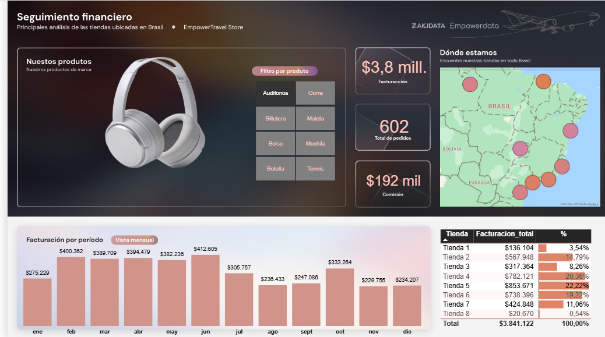
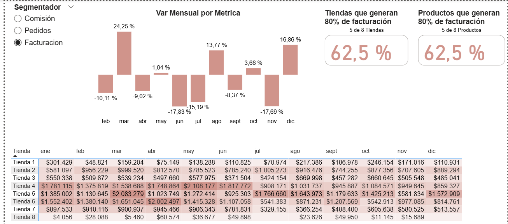

# 📈 Sales Performance & Revenue Tracking

Dashboard de Power BI construido a partir de una **masterclass de Zakidata (DaxusLatam)** y ampliado con mi propia capa analítica: tabla de fechas, medidas de inteligencia de tiempo, selector de métrica, mapa de calor tienda × mes y análisis de Pareto (ABC) por tienda y por producto.

🇬🇧 **[Read in English](README.md)**

---

## 🎯 Preguntas de negocio

1. ¿Cómo evolucionan la facturación, la comisión y el volumen de pedidos mes a mes?
2. ¿Qué tiendas y productos sostienen los ingresos y qué tan concentrados están?
3. ¿Dónde están los puntos débiles (tiendas o meses) que requieren atención comercial?

## 🧭 Qué es mío y qué viene de la masterclass

| Componente | Origen |
|---|---|
| Diseño de la página 1 (fondo, tarjetas, mapa, filtro de producto, gráfico mensual, tabla de tiendas) | Plantilla de la masterclass de Zakidata |
| Diseño de la página 2 y todos sus visuales | **Trabajo propio** |
| Tabla de fechas (`Calendario`) y medidas de inteligencia de tiempo | **Trabajo propio** |
| Selector de métrica (parámetro de campos) y variación mensual por métrica | **Trabajo propio** |
| Mapa de calor tienda × mes | **Trabajo propio** |
| Análisis de Pareto / ABC (tiendas y productos) y KPIs del 80% | **Trabajo propio** |

Algunos textos estáticos de la página 1 forman parte de la imagen de fondo de la plantilla (algunas etiquetas aparecen en portugués). Se dejaron sin modificar a propósito.

## 🖼️ Capturas

<!-- Sube las capturas a la carpeta 2.Screenshots y ajusta los nombres de archivo si son distintos -->
| Página 1 – Resumen | Página 2 – Detalle y Pareto |
|---|---|
|  |  |

## 📊 Contenido del dashboard

### Página 1 – Resumen (plantilla)
- Tarjetas KPI: facturación, total de pedidos y comisión.
- Mapa con la ubicación de las tiendas en Brasil.
- Filtro por producto, gráfico mensual de facturación y participación por tienda.

### Página 2 – Detalle y concentración (trabajo propio)
- **Selector de métrica** (Comisión / Pedidos / Facturación) que controla el gráfico de barras por tienda y el de variación mensual.
- **Variación mensual (MoM %)** de la métrica seleccionada.
- **Mapa de calor tienda × mes** de facturación (escala de color de `#F8EFEE` a `#D0948B`).
- **Gráficos de Pareto** por tienda y por producto, clasificados en A / B / C.
- **KPIs de concentración:** porcentaje de tiendas y productos que generan el 80% de la facturación.

## 🔍 Hallazgos clave (datos de 2023)

- **Los ingresos están bastante repartidos:** se necesitan 5 de 8 tiendas y 5 de 8 productos para llegar al 80% de la facturación. No hay una dependencia fuerte de una sola tienda ni de un solo producto.
- **Clasificación de tiendas:** las tiendas 2, 4, 5, 6 y 7 son clase A; la tienda 3 es clase B; las tiendas 1 y 8 son clase C.
- **Clasificación de productos:** Billetera, Bolso, Maleta, Mochila y Tennis son clase A; Audífonos y Botella son clase B; Gorra es clase C.
- **La Tienda 8** tiene un volumen muy bajo y no registró ventas de ningún producto en julio y diciembre (se ven como celdas vacías en el mapa de calor).
- **Las variaciones mes a mes son grandes:** por ejemplo, hay picos superiores a +20% y caídas cercanas a -18% dentro del mismo año.

## 🧮 Diccionario de KPIs

| KPI | Unidad | Definición | Decisión que habilita |
|---|---|---|---|
| `Facturacion_total` | Moneda del dataset | Suma de la facturación | Desempeño comercial general |
| `Comisión` | Moneda del dataset | Suma de las comisiones | Costo de ventas y planeación de incentivos |
| `Total_Pedidos` | Cantidad (pedidos) | Número de pedidos | Demanda y carga operativa |
| `Facturacion YTD` / `MTD` | Moneda | Facturación acumulada en el año / mes a la fecha | Avance frente al periodo |
| `Variación MoM % Métrica` | % | Cambio frente al mes anterior para la métrica seleccionada | Detectar aceleraciones o desaceleraciones |
| `Pareto % Acum` (tienda / producto) | % | Participación acumulada de la facturación, ordenada de mayor a menor | Visualizar la concentración |
| `Clase ABC` (tienda / producto) | A / B / C | A: primer 80% de la facturación, B: hasta 95%, C: el resto | Priorizar atención y recursos |
| `% Tiendas / Productos que generan el 80%` | % | Elementos clase A ÷ elementos con ventas | Medir el riesgo de concentración de ingresos |

## 🧱 Modelo de datos

- **Tabla de hechos:** `RegistroVentas` (pedidos, facturación, comisión, fecha del pedido).
- **Dimensiones:** `Tiendas`, `Productos`, `Calendario`.
- `Calendario` es una tabla de fechas calculada, marcada como tabla de fechas del modelo y relacionada con la fecha del pedido.
- Las medidas están organizadas en una tabla dedicada `_Medidas`.

## 🛠️ Stack técnico

Power BI Desktop · DAX (tabla de fechas calculada, inteligencia de tiempo, Pareto/ABC con `ALLSELECTED`, `FILTER` y `SUMX`, parámetros de campos) · Formato condicional y escalas de color personalizadas.

## ⚠️ Limitaciones

- El dataset cubre **solo 2023**, por lo que no es posible comparar año contra año.
- Es un dataset de práctica entregado por la masterclass, no datos reales de una empresa.
- El análisis de Pareto se calcula sobre facturación y, por diseño, no reacciona al selector de métrica.

## 📂 Archivos

- `1.Dashboard/` – reporte de Power BI (`.pbix`).
- `2.Screenshots/` – capturas de ambas páginas.
- `3.Dax/` – medidas DAX y tabla de fechas calculada.
- `4.Data/` – datos de origen usados por el reporte.

## 🙌 Créditos

Diseño de la página 1 y dataset base: masterclass de Zakidata (DaxusLatam). Todo lo listado como "Trabajo propio" fue desarrollado por mí sobre esa base.
